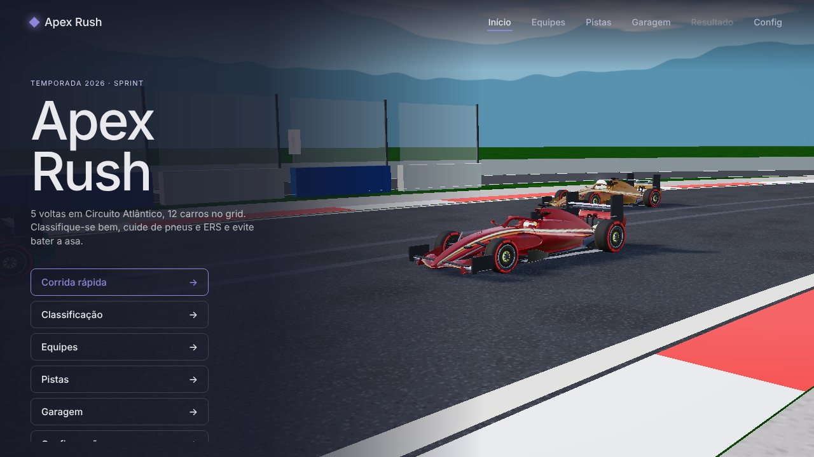

# Apex Rush

Jogo de corrida de Fórmula 1 em 3D que roda no navegador, feito com HTML, CSS, JavaScript e [Three.js](https://threejs.org/).

**Jogar no navegador:** https://lipefp.github.io/apexrush/



**Versão atual:** V20 (Stability Edition). O jogo está em desenvolvimento e homologação; ainda não é uma release final.

## Recursos

- Corrida contra 11 carros controlados pela IA, com classificação (Q1, Q2 e Q3) definindo o grid.
- Dez circuitos: dois fictícios e oito com traçado real (Xangai, Interlagos, Monza, Spa-Francorchamps, Silverstone, Red Bull Ring, Zandvoort e Montreal).
- Pneus macio, médio, duro, intermediário e de chuva, com desgaste e temperatura.
- Pit stop com pitlane, limitador de velocidade e equipe de box animada.
- DRS, ERS, dano na asa dianteira, safety car e clima variável.
- Câmeras de perseguição, T-cam e cockpit, com HUD configurável por câmera.
- Campeonato com pontuação da F1 e tabela de pilotos e equipes.
- Monitor técnico de desempenho (`F10`).

## Controles

| Ação | Teclas |
|---|---|
| Acelerar | `W` ou `↑` |
| Frear | `S` ou `↓` |
| Esterçar | `A` / `D` ou `←` / `→` |
| ERS (energia extra) | `Espaço` ou `E` |
| DRS | `F` ou `Q` |
| Câmera | `C` |
| Pausa | `P` ou `Esc` |
| Reiniciar corrida | `R` |
| Som liga/desliga | `M` |
| Freio de mão | `Shift` |
| Monitor técnico | `F10` |

Também aceita gamepad e controles por toque.

## Executar localmente

O jogo usa módulos ES e import maps, então precisa ser servido por HTTP (abrir o arquivo direto como `file://` não funciona).

```bash
python3 -m http.server 8080
```

Depois abra `http://localhost:8080`.

## Organização

```text
index.html             Jogo completo (V20)
assets/                Modelos, áudio e texturas extraídos no futuro
docs/                  Histórico de versões, auditoria, processo e plano de deploy
deploy/                Preparação para hospedagem
scripts/               Validação local
```

Hoje o `index.html` concentra o jogo inteiro, com modelos e sons embutidos. A separação em módulos e arquivos de assets está no [roadmap](ROADMAP.md) e será feita aos poucos, com testes de regressão.

## Validação

O GitHub Actions confere a sintaxe dos scripts a cada push. Para rodar a mesma checagem localmente:

```bash
python3 scripts/validate-inline-js.py
```

A checagem cobre sintaxe JavaScript. Física, áudio, WebGL e desempenho são testados no navegador, seguindo o [checklist de release](docs/RELEASE_CHECKLIST.md).

## Estado e problemas conhecidos

Os problemas abertos estão nas [Issues](https://github.com/lipefp/apexrush/issues). A análise completa da V20 está em [`docs/AUDITORIA_V20.md`](docs/AUDITORIA_V20.md) e [`docs/REVISAO_INDEPENDENTE_V20.md`](docs/REVISAO_INDEPENDENTE_V20.md).

## Fluxo de desenvolvimento

- `main`: última versão estável.
- `develop`: integração das próximas mudanças.
- `feature/<assunto>`: mudanças isoladas.
- Tags `vX.Y.Z`: versões arquivadas. O histórico de cada uma está em [`docs/VERSION_HISTORY.md`](docs/VERSION_HISTORY.md).

Detalhes em [`docs/DEVELOPMENT_WORKFLOW.md`](docs/DEVELOPMENT_WORKFLOW.md).

## Créditos

Modelos, sons e traçados de terceiros estão listados em [`CREDITS.md`](CREDITS.md).

## Direitos

© 2026 Felipe Diniz. Todos os direitos reservados. O código está público para consulta, mas não há licença de uso, cópia ou redistribuição. Os recursos de terceiros seguem as licenças dos seus autores.
